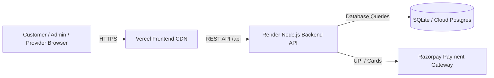

# 🚀 FixNear India — Complete Deployment Guide (100% Free Tier)

This guide takes you step-by-step through deploying both the **Node.js Express Backend** (on **Render**) and the **React Vite Frontend** (on **Vercel**), with custom domains and payment gateways.

---

## 🏗️ Architecture Overview



---

## 📦 Step 1: Push Code to GitHub

1. Open your terminal in the project root:
   ```bash
   cd C:\Users\harsh\.gemini\antigravity\scratch\fixnear
   git init
   git add .
   git commit -m "feat: complete FixNear India platform with JWT auth and Razorpay"
   ```
2. Create a new repository on [GitHub](https://github.com/new) named `fixnear`.
3. Push your repository:
   ```bash
   git remote add origin https://github.com/<YOUR_GITHUB_USERNAME>/fixnear.git
   git branch -M main
   git push -u origin main
   ```

---

## ⚙️ Step 2: Deploy Backend to Render (Free Tier)

1. Sign up / Log in to [Render](https://render.com/) with GitHub.
2. Click **New +** -> **Web Service**.
3. Select your `fixnear` repository.
4. Configure the Web Service:
   * **Name**: `fixnear-backend`
   * **Root Directory**: `backend`
   * **Environment**: `Node`
   * **Region**: `Singapore` (Fastest latency for India 🇮🇳)
   * **Branch**: `main`
   * **Build Command**: `npm install`
   * **Start Command**: `node src/index.js`
5. Under **Environment Variables**, add:
   * `NODE_ENV`: `production`
   * `PORT`: `5000`
   * `JWT_SECRET`: *(Click 'Generate' or enter any 32+ character random string)*
   * `FRONTEND_URL`: `https://fixnear.vercel.app` *(or your Vercel URL once created)*
   * *(Optional)* `RAZORPAY_KEY_ID`: *(Your Razorpay Key ID if using live payments)*
   * *(Optional)* `RAZORPAY_KEY_SECRET`: *(Your Razorpay Key Secret)*
6. Click **Create Web Service**.
7. Render will build and deploy. Once live, copy your backend URL:
   `https://fixnear-backend.onrender.com`

---

## 🌐 Step 3: Deploy Frontend to Vercel (Free Tier)

1. Sign up / Log in to [Vercel](https://vercel.com/) with GitHub.
2. Click **Add New...** -> **Project**.
3. Import your `fixnear` repository.
4. Configure Project Settings:
   * **Framework Preset**: `Vite`
   * **Root Directory**: Click `Edit` and select `frontend`
5. Under **Environment Variables**, add:
   * `VITE_API_URL`: `https://fixnear-backend.onrender.com` *(Your Render URL from Step 2)*
6. Click **Deploy**.
7. Within 60 seconds, your site is live globally on a free `*.vercel.app` domain!

---

## 💳 Step 4: Activating Razorpay India Payments

* FixNear is already configured with a **Built-in Smart Payment Gateway Simulator**:
  * If no keys are provided, it automatically creates valid simulated orders and generates real-format transaction receipts (`pay_rzp_...`).
  * If you want real UPI / Card payments, sign up at [dashboard.razorpay.com](https://dashboard.razorpay.com):
    1. Go to **Settings** -> **API Keys**.
    2. Generate **Test Key ID** and **Key Secret**.
    3. Add them to your Render backend environment variables:
       * `RAZORPAY_KEY_ID=rzp_test_xxxxxx`
       * `RAZORPAY_KEY_SECRET=xxxxxx`
    4. Save & Redeploy.

---

## 🔑 Default Production Demo Credentials

| Role | Name | Email | Password |
| :--- | :--- | :--- | :--- |
| 🛡️ **Admin** | Harsh | `harsh@fixnear.in` | `password123` |
| 👤 **Customer** | Priya Sharma | `priya@fixnear.in` | `password123` |
| ⚡ **Electrician Pro** | Alex Vance | `alex@apexpower.in` | `password123` |
| 🔧 **Plumber Pro** | Rajesh Kumar | `rajesh@rapidflow.in` | `password123` |
